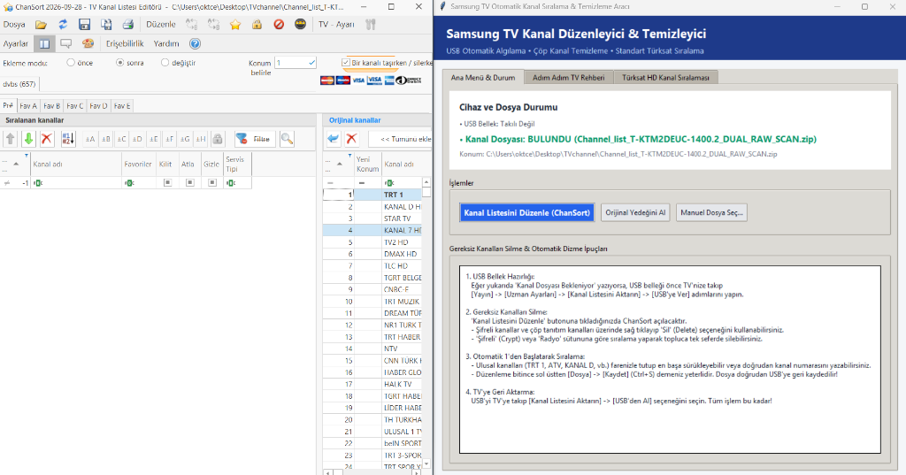

# 📺 Samsung TV Kanal Düzenleyici & Temizleyici (Tizen OS)

Samsung Smart TV'ler (Tizen OS) için USB üzerinden aktarılan kanal listelerini otomatik olarak analiz eden, gereksiz ve şifreli yayınları ayıklayan, Full HD kanalları 1'den başlatarak düzenleyen ve radyo istasyonlarını kumandaya entegre eden açık kaynaklı masaüstü yönetim aracı.



---

## 🚀 Öne Çıkan Özellikler

* **⚡ Tek Tıkla Otomatik Sıralama:** Kumandayla saatlerce uğraşmaya son! Ulusal, belgesel, dizi, müzik, haber ve spor kanallarını mantıksal bir sırayla 1'den başlayarak otomatik dizer.
* **✨ Sadece Yüksek Kalite (Full HD):** Bir kanalın hem HD hem de SD versiyonu varsa çamur kalitedeki SD yayınları tamamen temizler, sadece Full HD yayınları korur.
* **🧹 Sıfır Çöp & Şifreli Kanal:** Şifreli yayınlar, boş sinyaller (`vidPid: 65535`), bal/saat reklam kanalları, test taşıyıcıları ve teleshopping kanalları kökten silinir.
* **🚫 Filtreleme Koruması:** Kullanıcı tercihine göre dini kanallar, dini radyolar veya istenmeyen haber kanalları (örn: Ülke TV, Ekol TV, Ekotürk vb.) tek tıkla filtrelenir.
* **📻 Kumanda Entegre Radyo Dizilimi:** TV ve radyoyu ortak kullananlar için en popüler radyo istasyonlarını (Kral Pop, Power FM, Süper FM, Metro FM vb.) kumandadan tek tuşla erişilebilecek şekilde **61'den itibaren** numaralandırır.
* **🛡️ Güvenli SQLite & Bütünlük Kontrolü:** Samsung'un `dvbs` ve `sat` veritabanlarında `PRAGMA integrity_check` ve `VACUUM` çalıştırarak dosya bozulmalarını önler, orijinal yedeği otomatik saklar.
* **🛠️ ChanSort Desteği:** İsteğe bağlı olarak gelişmiş elle düzenleme için açık kaynaklı [ChanSort](https://github.com/Predr/ChanSort) editörünü otomatik dosya yüklenmiş halde başlatabilir.

---

## 📺 Örnek Kanal Sıralaması

| Kanal No | Tür | Kategori / Kanal Adı |
| :---: | :---: | :--- |
| **1 – 9** | TV | **Ulusal Kanallar (Full HD):** TRT 1, ATV, KANAL D, SHOW TV, STAR TV, NOW (FOX), TV8, KANAL 7, BEYAZ TV |
| **10 – 15** | TV | **Belgesel & Dizi (Full HD):** DMAX, TLC, TRT Belgesel, Teve2, CNBC-e, TGRT Belgesel |
| **16 – 18** | TV | **Müzik (Full HD):** TRT Müzik, Dream Türk, NR1 Türk TV |
| **19 – 28** | TV | **Haber & Gündem (Full HD):** NTV, TRT Haber, CNN Türk, Haber Global, Sözcü TV (SZC), Habertürk, Halk TV, A Haber, TGRT Haber, Flash TV |
| **29 – 36** | TV | **Spor (Full HD):** beIN Sports Haber, TRT Spor, TRT Spor Yıldız, A Spor, HT Spor, TV8.5, TJK TV |
| **37 – 41** | TV | **Çocuk & Kültür:** TRT Çocuk, Minika GO, Minika Çocuk, Cartoon Network, TRT 2 |
| **42 – 52** | TV | **Dünya & Kıbrıs HD:** NHK World-JPN, TRT World, Bloomberg HT, BRT 1-2, Kıbrıs TV, Euro D, Eurostar |
| **61 – 85** | Radyo | **Popüler Müzik Radyoları:** Kral Pop, Kral FM, Power FM, PowerTürk, Metro FM, Süper FM, Slow Türk, Joy Türk, Joy FM, Virgin, Fenomen, Best FM, Show Radyo, Radyo D, Kafa Radyo, Pal Nostalji, TRT FM... |
| **121+** | TV | **Bölgesel ve Yerel Açık TV Kanalları** |

---

## 🛠️ Nasıl Kullanılır?

### 1. Adım: Kanal Listesini TV'den USB'ye Alın
1. FAT32 formatlı bir USB belleği televizyonunuza takın.
2. TV Kumandanızdan: **Ayarlar (Settings) > Yayın (Broadcasting) > Uzman Ayarları (Expert Settings)** menüsüne girin.
3. **Kanal Listesini Aktarın (Transfer Channel List)** seçeneğini açın.
4. **USB'ye Ver (Export to USB)** seçeneğini seçin *(PIN kodu sorarsa varsayılan: `0000`)*.
5. TV "Kanal listesi aktarıldı" uyarısı verince belleği çıkarın.

### 2. Adım: Bilgisayarda Düzenleyin
1. USB belleği bilgisayarınıza takın.
2. Projedeki `Kanal_Duzenleyici.bat` dosyasını çalıştırın (veya `python Samsung_Kanal_Yoneticisi.py`).
3. Program USB belleğinizi ve kanal dosyasını anında yeşil renkle algılayacaktır.
4. **"⚡ TEK TIKLA OTOMATİK TEMİZLE VE SIRALA"** butonuna basın.
5. İşlem 1-2 saniye içinde tamamlanıp dosya doğrudan USB'ye geri kaydedilecektir.

### 3. Adım: USB'yi TV'ye Geri Yükleyin
1. USB belleği tekrar televizyonunuza takın.
2. Aynı menüden: **Yayın > Uzman Ayarları > Kanal Listesini Aktarın** bölümüne gelin.
3. Bu kez **USB'den Al (Import from USB)** seçeneğini seçin.
4. Televizyonunuz kanalları anında yükleyip yeniden başlayacaktır. Yeni, Full HD ve tertemiz listeniz hazır!

---

## 💻 Kurulum & Gereksinimler

* **İşletim Sistemi:** Windows 10 / 11
* **Python:** Python 3.8+ (Standart kütüphaneler dışında harici paket bağımlılığı gerektirmez - `tkinter`, `sqlite3`, `zipfile`).

Projeyi klonlamak için:
```bash
git clone https://github.com/KULLANICI_ADINIZ/samsung-tv-channel-manager.git
cd samsung-tv-channel-manager
python Samsung_Kanal_Yoneticisi.py
```

---

## 📜 Lisans
Bu proje [MIT Lisansı](LICENSE) altında açık kaynak olarak sunulmaktadır.
ChanSort açık kaynaklı [GPL-3.0](https://github.com/Predr/ChanSort) lisansına tabidir.
